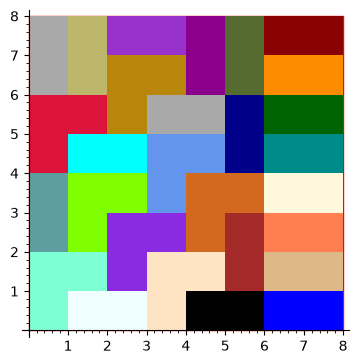
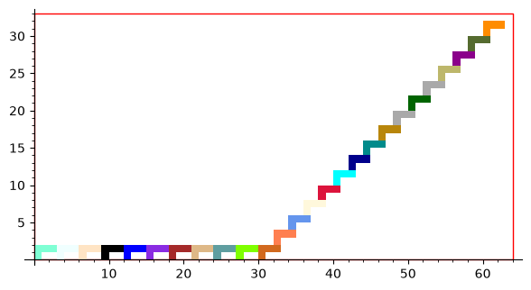

# Projet Tétris : polyominos, pavages et « ponts »

Exploration des polyominos (les pièces de Tétris) en Python/SageMath : représentation par matrices, classes de rotation et de symétrie, pavage de rectangles par backtracking, caractérisation par convolution, et un algorithme maison pour relier deux points avec des pièces qui tombent.



*Sortie réelle de `pavage_2d` (notebook `pavage.ipynb`) : pavage d'un carré 8×8 avec trois pièces fixes (un L de 3 cases, un domino vertical, un domino horizontal). Image régénérée en octobre 2026 en exécutant le code tel que rendu.*

## Contexte

| | |
|---|---|
| Cours | Projet Math-Informatique, Licence double diplôme Informatique-Mathématiques (LDD IM), 1re année, semestre 2 |
| Établissement | Université Paris-Saclay (Faculté des Sciences d'Orsay) |
| Période | mars à mai 2024 (soutenance orale début mai 2024) |
| Équipe | 3 étudiants : Oscar Cavalieros, Niccolo Angeloti, Carlos Clement |
| Rendus | un rapport de mi-projet (questions théoriques, non inclus ici), puis un exposé de 10 minutes sur la partie exploration |

Le sujet proposait des pistes de recherche libres autour des polyominos ; ce dépôt contient la partie « exploration par l'informatique ».

## Ce que fait le projet

1. **Représentation des polyominos** : une matrice de 0 et de 1 (NumPy), avec rotation (`np.rot90`), symétries horizontale et verticale, calcul des classes de rotation et de symétrie, recadrage au plus petit rectangle.
2. **Pavage en 1 dimension** : paver une bande de longueur *n* avec des segments de longueurs données. Une première version gloutonne échoue sur certains cas (ex. paver 6 avec 3 et 4) ; la seconde ajoute le retour arrière (backtracking).
3. **Pavage en 2 dimensions** (`pavage_2d`) : on choisit la « cible », c'est-à-dire la case vide la plus basse puis la plus à gauche. Sans rotation, chaque pièce n'a au plus qu'une position possible pour la couvrir. On essaie chaque pièce, on continue récursivement et on revient en arrière en cas d'impasse. Chaque étape est dessinée, ce qui donne les animations du dossier `resultats/`.
4. **Algorithme du « pont »** (`pont`) : on empile des copies d'une même pièce, en respectant la gravité de Tétris, pour aller d'un point A à un point B. On calcule les pentes atteignables en posant la pièce suivante, et on garde la plus forte qui ne dépasse pas la pente vers B.
5. **Caractériser une classe de polyominos par des nombres** :
   - polyomino vu comme un graphe : *degré potentiel* = 4 × aire, *degré réel* = nombre d'adjacences, et **degré potentiel − degré réel = périmètre** ;
   - périmètre et contour obtenus par **convolution 2D** avec le noyau laplacien `[[0,1,0],[1,-4,1],[0,1,0]]`, avec une preuve manuscrite (`rapport/Preuve.jpeg`) que seules les cases du contour ressortent positives ;
   - généralisation avec des liaisons plus longues (noyaux de convolution de plus en plus grands) : on obtient une signature qui distingue beaucoup plus de formes, mais pas toutes à partir de la taille 6.
6. **Polyominos « sécables »** : peut-on couper la pièce en deux moitiés identiques (sans rotation) par une droite horizontale ou verticale ?
7. **Génération exhaustive** (`generate_all`) : on part d'une case et on ajoute des cases voisines récursivement. Voir les limites ci-dessous.

### Exemple de « pont »



*Sortie réelle de `pont((60, 30), …)` avec une pièce en L de 4 cases, régénérée en octobre 2026. D'autres animations d'époque (`pontNez.gif`, `pontCroix.gif`, `pavage.gif`…) sont dans `resultats/`.*

## Maths et techniques utilisées

- Combinatoire des polyominos (forme fixe, classes de rotation, de symétrie et classe complète).
- Recherche exhaustive avec retour arrière (backtracking).
- Théorie des graphes élémentaire : degrés, lien avec l'aire et le périmètre.
- Convolution discrète 2D (`scipy.signal.convolve2d`), avec une preuve de correction du détecteur de contour.
- Python, NumPy, SciPy, SageMath (dessins `polygon2d`, animations `animate`).

## Organisation du dépôt

```
notebooks/
  with_numpy.ipynb    version principale : représentation NumPy, classes, génération, degrés, convolution, sécabilité
  pavage.ipynb        pavage 2D avec animation, algorithme du pont
  tetris.ipynb        premières versions (listes Python, classes Polyomino V1/V2, pavage 1D)
  with_lists.ipynb    toute première version avec des listes (Python pur)
rapport/
  avancees_partie2.odt (+ export .pdf)   rapport d'avancement de la partie exploration
  PMI_Partie2.md                         notes de travail
  Preuve.jpeg                            preuve manuscrite du détecteur de contour
presentation/
  Presentation_finale.pptx (+ export .pdf)   support de la soutenance
resultats/            animations GIF et APNG produites par le programme à l'époque, nb_pols.txt
captures/             images régénérées en 2026 depuis le code d'origine (pour ce README)
```

Les notebooks sont conservés **tels que rendus**, avec leurs sorties d'origine. Ils ont été exécutés dans le désordre à l'époque, d'où des numéros d'exécution `[n]` non consécutifs.

## Lancer le projet

Les notebooks `with_numpy`, `pavage` et `tetris` demandent un noyau **SageMath** (ils ont été écrits avec SageMath 10.2). `with_lists` tourne avec un Python ordinaire.

Installation via [passagemath](https://github.com/passagemath/passagemath), la distribution de Sage installable avec pip :

```bash
python3 -m venv .venv
source .venv/bin/activate
pip install passagemath-standard jupyterlab scipy
# déclarer le noyau « sagemath » auprès de Jupyter
# (un message d'erreur « File exists » à la fin est sans conséquence)
python -c "import sys; from sage.repl.ipython_kernel.install import SageKernelSpec; SageKernelSpec.update(prefix=sys.prefix)"
jupyter lab notebooks/
```

On peut aussi utiliser une installation classique de SageMath : `sage -n jupyter`.

**Vérifié en octobre 2026** avec passagemath 10.8.13 sous Python 3.13 (Linux) : chaque notebook s'exécute de haut en bas. Les seules erreurs sont celles déjà présentes dans les sorties d'origine (voir ci-dessous). `with_numpy.ipynb` prend environ 7 minutes, car il énumère jusqu'à 118 334 formes. Les résultats sont identiques à ceux d'origine, avec deux différences mineures : NumPy 2 affiche `np.int64(12)` au lieu de `12`, et une sortie enregistrée (classe de rotation, cellule 41) provenait d'un état antérieur du notebook ; le code actuel donne le bon résultat, 2 rotations distinctes.

## Ma contribution

Projet réalisé à trois. Le code ne contient pas d'annotations d'auteur, donc ce README ne détaille pas la répartition du travail entre les membres.

## Limites connues

Le code est laissé tel que rendu ; les problèmes ci-dessous sont documentés, pas corrigés.

- **`generate_all` ne génère pas tous les polyominos.** Chaque nouvelle case est ajoutée à côté de la *dernière* case posée. On ne trouve donc que les polyominos qu'on peut parcourir d'un seul trait, case par case (ceux qui admettent un chemin hamiltonien). Le T de Tétris en est exclu. D'où la suite 1, 2, 6, **15, 42**, 112… de `resultats/nb_pols.txt`, au lieu de 1, 2, 6, **19, 63**, 216… pour les polyominos à forme fixe (OEIS A001168). J'ai vérifié cette explication avec un script indépendant : les deux suites coïncident exactement jusqu'à la taille 9. Les statistiques calculées à partir de `generate_all` (sécabilité, signatures de degrés) portent donc sur ce sous-ensemble.
- **`perimeter2`** compte les *cases* du contour au lieu des *arêtes* du bord. Il sous-estime donc le périmètre des formes concaves (T de 4 cases : 8 au lieu de 10). La fonction `perimeter` (par translation de matrices) et la somme des valeurs de `outline2` donnent le bon résultat.
- **`pavage.ipynb`, cellules 1 et 2** : `pavage_1d` a perdu sa ligne d'appel récursif et plante. Sous Sage, `r` désigne l'interface vers le logiciel R, d'où le message inhabituel `TypeError: … 'R' and 'list'`. La version fonctionnelle est `pavage_1d_v2` dans `tetris.ipynb`.
- **`tetris.ipynb`** contient des versions abandonnées : `PolyominoV1` plante (`ValueError`), `pavage_2d_v1` n'est qu'une signature vide (erreur de syntaxe), et `PolyominoV2.rotate` / `pol2matrix` sont faux (ce dernier utilise une variable globale `p`).
- **Pavage 2D** : pas de rotations ni de symétries, et une recherche exponentielle dans le pire cas. La première pièce est numérotée 0, donc invisible, ce qui ajoute une étape inutile. L'appel de démonstration est resté dans une chaîne de documentation (cellule 6 de `pavage.ipynb`).
- **Pont** : la hauteur du point B est en fait imposée par le code (`pB = pB[0]-1, 2`). La valeur `-1` sert à la fois de pente réelle et de code « verticale ». Le pont peut dépasser légèrement B.
- `est_correct` (`with_numpy.ipynb`) ne fait pas ce que son nom indique (elle sort dès le premier tour de boucle) ; elle n'est utilisée nulle part.
- La partie « Spécial Tétris » du sujet (placement optimal des pièces qui tombent) n'a pas été traitée.

## Crédits

- Sujet et cadre du projet : équipe enseignante du « Projet Math-Informatique » de la LDD IM, Université Paris-Saclay. Le sujet n'est pas redistribué ici.
- Design de la présentation : modèle « Super Pixel Vintage Gaming » de [Slidesgo](https://slidesgo.com), illustrations [Freepik](https://www.freepik.com).
- Dessins et animations : [SageMath](https://www.sagemath.org).
